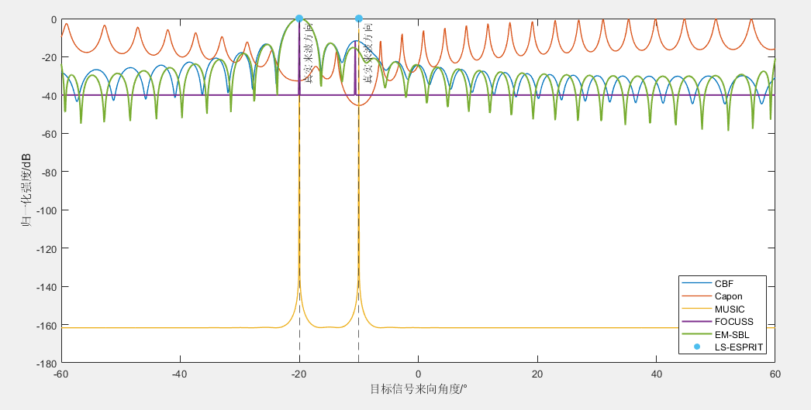
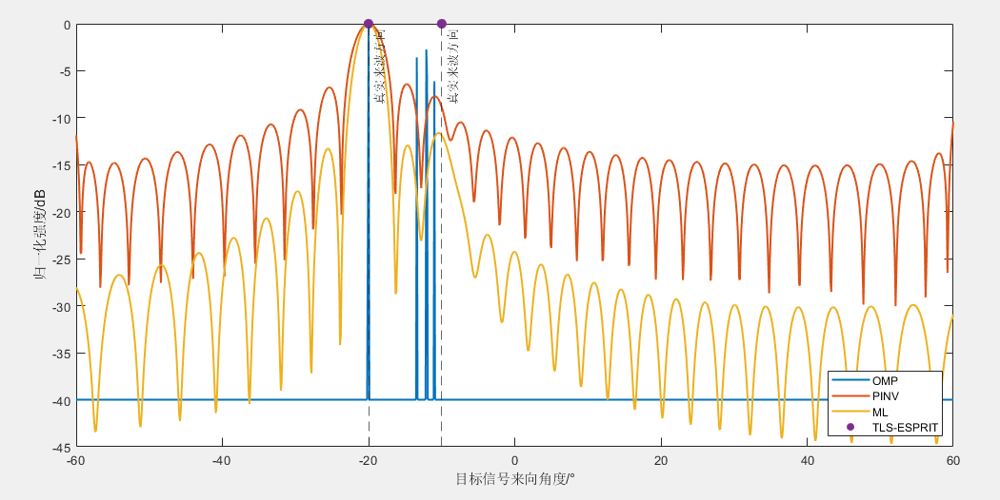

# [DOA Estimation] From Beamforming to Sparse Reconstruction: The Evolution, Breakthroughs, and Future of Array Direction-of-Arrival Technology with MATLAB Codes

From Beamforming to Sparse Reconstruction: The Evolution, Breakthroughs, and Future Precision Positioning in Array Direction Finding Technology, which is an eternal pursuit in the fields of radar, communication, and electronic reconnaissance. In radar detection, wireless communication, and electronic countermeasures, precisely estimating the arrival direction (DOA) of a signal is one of the core technologies. Imagine our ears can distinguish the direction from which a sound comes, relying on the time difference and intensity difference between the two ears receiving the sound. And array antennas, like having multiple "ears", can precisely "listen" out of the complex electromagnetic wave environment by using specific algorithms.
This article will start from the basic model, systematically sort out the evolutionary path of array direction finding technology from classical beamforming to modern sparse reconstruction, and combine a series of core algorithms to analyze its performance characteristics and applicable scenarios.
I. The Basis of Everything: Signal Model
To understand direction finding, we first need to establish a mathematical model. Assuming there is an uniform linear array composed of N elements in space, with an adjacent element spacing of . When a narrow-band signal with a wavelength of propagates at an angle into the array, due to the different distances to different elements, a phase difference is generated. Combining the phase relationships of all received signals from all elements forms the steering vector for this particular direction:
Combining all possible directions of interest into a matrix of steering vectors forms an array manifold matrix, also known as an "overcomplete dictionary" in subsequent sparse reconstruction theory. The received signal from the array can be simply represented as:
Where is the source signal vector, and is the noise vector. Our core task is to infer the direction information of the source from the received data.
II. Classic Methods: Beamforming and Subspace Decomposition
1. Conventional and Time-Varying Filtering: CBF and Capon are the most intuitive methods for direction finding. It's like scanning in space: weighting the received signal by the steering vector for a certain assumed direction and summing up the output power at that direction.
Its spectral estimation can be represented as:
The CBF (Covariance Matrix Based Fusion) is robust but its resolution is limited by the "Rayleigh limit" - that is, it cannot distinguish between two targets within the same beam width.
To overcome this limitation, the Capon algorithm (also known as the Minimum Variance Distortionless Response, MVDR) emerged. It adopts an adaptive filtering idea: under the constraint of ensuring the desired direction signal passes undistorted, it minimizes the total power output from the array. This is equivalent to a sharp spatial bandpass filter, whose spectral estimation is:
The Capon method can effectively suppress interference and noise, with significantly better resolution than CBF, but it requires higher stability for the inverse of the covariance matrix.
Subspace breakthrough: MUSIC and ESPRIT
In the 1980s, a revolutionary subspace method was proposed, achieving a significant leap in target resolution.
The core idea of the Multiple Signal Classification (MUSIC) algorithm is feature decomposition. It decomposes the covariance matrix into a signal subspace and a noise subspace, which are mutually orthogonal. Based on this, a "pseudo spectrum" can be constructed:
When the scanning steering vector points towards the true source direction, it is in the signal subspace and orthogonal to the noise subspace, and the denominator in the above equation tends to zero, thus producing a sharp spectral peak. The MUSIC algorithm achieves super-resolution, allowing clear discrimination even when two targets are very close in angle.
Another major category is the Rotating Invariant Subspace (ESPRIT) algorithm. It cleverly utilizes the translation invariance of uniform linear arrays without needing to search for a spectral peak, but instead, it directly solves for a rotation operator matrix's eigenvalues through the rotation relationship between two subarray signal subspaces, thereby solving for all target azimuth angles.
The computational efficiency of ESPRIT is much higher than MUSIC, making it highly suitable for real-time processing. Its derivatives of the maximum likelihood (ML) criterion and the overall least squares (TLS) criterion further optimize the estimation accuracy under different noise conditions.
III. Modern Methods: Revolutionary Traditional Techniques in Sparse Reconstruction
The core idea is: the number of sources in real space is always scarce. We divide the entire angle space into a very fine grid, which is very large. Therefore, the receiving signal model can be rewritten as:
At this point, it is a vector of dimensionality, where only the elements corresponding to the actual source position are non-zero, indicating sparsity. The problem is transformed into solving a sparse vector under an underdetermined system of equations.
The FOCUSS algorithm in this series of codes is a classic sparse reconstruction method. It solves a weighted least norm solution iteratively, the iteration steps are summarized as follows:
1  
Initialize the sparse solution.
2  
Construct a weighted matrix, where is the sparsity factor.
3  
Solving the weighted least squares problem:
4  
Check the convergence conditions, if not satisfied, return to step 2.
FOCUSS can achieve high-precision direction finding from single or very few fast shots, and is naturally immune to coherent signals.
Another classic greedy algorithm is Orthogonal Matching Pursuit (OMP). It reconstructs sparse signals in a "stepwise elimination" manner: at each iteration, it selects the atom with the highest correlation to the current residual signal from the dictionary (i.e., the steering vector), adds it to the selected set, and then re-estimates the signal on the selected set atoms and updates the residual. OMP implementation is simple and computationally fast, and is widely used in engineering applications.
Furthermore, the pseudo-inverse method directly seeks the solution with minimum norm, which is equivalent to a special case without sparse constraints and has limited resolution.
The EM-SBL algorithm, standing on the height of Bayesian statistics, assumes an independent and parameter-controlled prior distribution for each component of the sparse vector. Through the expectation-maximization (EM) algorithm, it iteratively learns these parameters. The components that are less important will tend towards zero, thereby automatically determining the sparsity. SBL performs exceptionally well in terms of parameter adaptation.
IV. Performance Comparison: A Comprehensive Overview of Methods' Advantages and Disadvantages
Algorithm
Resolution
Noise resistance
Coherent signal processing
Complexity calculation
Is there a need for source data?
CBF low
Strong
Yes
Low
No
In Capon
Strong
Yes
Chinese
No
MUSIC
Chinese
Cannot
(Requires coherence)
Middle to high
Yes
LS/TLS-ESPRIT high
Chinese
Cannot
(Requires coherence)
Chinese (no need to search)
Yes
ML high
The strongest
Extremely high
(Multi-peak search)
No
FOCUSS extremely high middle
Natural immunity
No
High-end in OMP
Strong
Natural immunity
No
EM-SBL extremely high and strong
High natural immunity
No
For example, in a real-world scenario: A car's multiple input multiple output (MIMO) radar needs to simultaneously monitor pedestrians (weak targets) near the car and another vehicle at a distance (strong reflection).
CBF will cause the sidelobes of strong targets to overshadow weak ones due to excessive sidelobes; Capon can form nulls in the direction of strong targets, suppressing their interference and thereby extracting weak targets. If the angles between two vehicles are too close, only algorithms such as MUSIC or ESPRIT can successfully separate them.
For the multipath effect (which generates coherent signals) often encountered by onboard radar, CBF and Capon can work normally, but MUSIC/ESPRIT will fail. In this case, sparse reconstruction methods such as FOCUSS and OMP can be advantageous.
It is worth mentioning that when dealing with coherent signals, MUSIC and ESPRIT can fail due to the loss of signal subspace rank. A classical solution is spatial smoothing techniques: dividing the entire array into multiple overlapping subarrays, averaging the covariance matrices of these subarrays to disrupt signal coherence and restore full rank in the subspace, before re-introducing MUSIC/ESPRIT for use.
The EM-SBL algorithm not only accurately estimates the DOA but also automatically trims irrelevant dictionary atoms, resulting in sparse and clean output. In scenarios with low signal-to-noise ratio and few fast shots, its performance surpasses that of traditional compression-sensing methods.
V. Future Outlook: Array Direction Finding Technology is continuously evolving in the following directions:
1  
Off-grid and gridless methods currently have sparse reconstructions defaulting to preset discrete grids, which easily leads to base mismatch errors. The off-grid and atomic norm gridless methods are addressing this issue fundamentally.
2  
The integration of deep learning introduces the nonlinear fitting capability of deep neural networks into DOA estimation, directly mapping target angles from raw array data at the end-to-end level, which has great potential in model error and complex noise scenarios.
3  
Millimeter Wave and Ultra-Large Scale MIMO5G/6G base stations form extremely narrow high gain beams, necessitating low complexity, high accuracy DOA (Direction of Arrival) algorithms to support real-time beam management and tracking.
4  
The dynamic and tracking of the scene target's angle changes rapidly when moving, combined with Kalman filtering and particle filtering Bayesian dynamic DOA tracking, is the core technology to ensure the continuity and reliability of positioning.
The series of algorithms introduced in this paper, from the classic CBF, Capon to the super-resolution MUSIC, ESPRIT, and then to the cutting-edge FOCUSS, OMP, EM-SBL, sketches out a magnificent panorama of array signal processing technology.
Every algorithm has its exclusive design logic and optimal application scenarios. Whether it's radar engineers, communication researchers, or students of signal processing, mastering this DOA algorithm system can enable precise perception, positioning, and insight into spatial targets in the world of electromagnetic waves.

## Images

<!-- PAYMENT_BLOCK -->

## Get this dataset

- Payment link (Stripe): [Buy now](https://buy.stripe.com/3cs8yP7sY87d0vu9AB)
- Payment QR code: 

<!-- /PAYMENT_BLOCK -->
